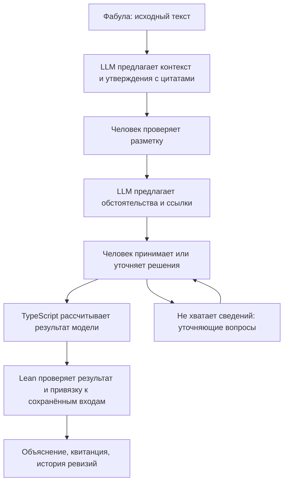

# NormLab

**Лаборатория исполняемого права: от рассказа о событии — к явным основаниям, воспроизводимому расчёту и проверке в Lean.**

Можно ли показать, почему из этих обстоятельств следует именно этот результат?
Что изменится, если уточнить один факт, добавить исключение или переписать норму?
Сохранит ли новая редакция прежние последствия — и где найдётся контрпример?

NormLab превращает такие вопросы в проверяемые эксперименты. В репозитории уже
есть веб-приложение с парковочным PoC, лаборатория сравнения синтетических норм
A/B/C и формальное ядро на Lean. LLM помогает подготовить разбор, человек принимает
решения об обстоятельствах, код рассчитывает результат, а Lean независимо
проверяет его соответствие заданной модели.

[Запустить](#запуск) · [Попробовать парковку](#один-эпизод-парковки) · [Что доказывает Lean](#где-здесь-lean) · [Исследовать изменение закона](#проверять-изменения-норм-до-их-применения) · [Roadmap](roadmap.md)

## Проблема: убедительное объяснение ещё не проверенный вывод

Юридический текст соединяет условия, исключения, роли участников и последствия.
Рассказ о событии добавляет неполные сведения, чужие слова и противоречия.
Если эту цепочку свернуть в один ответ, трудно заметить, где именно изменился смысл:
кто-то сказал «оплатил», это стало фактом успешной оплаты, а затем основанием решения.

Та же проблема возникает при разработке с AI: намерение человека проходит через
описание, модель и код. Тысячи строк могут согласовываться друг с другом и всё же
реализовывать другой замысел.

**NormLab делает переходы между представлениями предметом проверки.** Утверждение
сохраняет цитату; решение человека — основание и ревизию; расчёт — входы и правила;
формальная проверка — точный результат и область, к которой относится доказательство.
Ошибка получает место в этой цепочке, где её можно исправить и пересчитать результат.

## Один эпизод парковки

Возьмём учебную фабулу: водитель оставил личный автомобиль на платной городской
парковке в Москве и не оплатил указанный интервал.



Путь работает в разделе парковочного разбора: сохранить текст, предложить и
подтвердить контекст, запустить авторазбор, проверить утверждения, принять
кандидатов юридических обстоятельств и нажать **«Рассчитать и проверить в Lean»**.
Ввод и исправление вручную доступны отдельно. Автоматические предложения требуют
[настроенного inference gateway](docs/HOSTED_INFERENCE.md).

Результат меняется вместе с выбранными обстоятельствами. В таблице остальные
условия считаются установленными и не вызывают конфликтов или выхода за scope:

| Что установлено в пределах выбранного эпизода                      | Что показывает упрощённая модель            |
| ------------------------------------------------------------------ | ------------------------------------------- |
| Все условия фрагмента выполнены, включая отсутствие оплаты         | Условия выполнены; санкция-кандидат 5 000 ₽ |
| Установлена своевременная оплата правильного ТС за нужный интервал | Условие неоплаты опровергнуто               |
| Для существенного условия недостаточно сведений                    | Требуется уточнение                         |
| Сохранены противоположные установления                             | Конфликт                                    |
| Есть поздняя оплата или иной случай вне поддержанного сценария     | Сценарий выходит за границы пилота          |

Это PoC выбранного фрагмента ч. 2 ст. 8.14 КоАП города Москвы. Сумма — кандидат
из исследованной модели, а не назначенный штраф. Полная квалификация,
ответственность конкретного лица и подтверждение действующей редакции закона
не входят в этот расчёт. Для эксперимента правила заданы явно, поэтому их
можно исполнять и проверять уже сейчас.

Проверка разметки и установление обстоятельства разделены: точная цитата
«я заплатил» ещё не устанавливает успешную оплату нужного автомобиля и интервала.
Отсутствие сведений не превращается в отрицание. Модель предлагает кандидатов;
человек может принять, исправить или оставить вопрос открытым.

[Пять учебных сценариев](fixtures/parking-pilot/walkthroughs/README.md) · [Начало авторазбора](docs/PARKING_AUTO_ANALYSIS_START.md) · [Контракт обстоятельств](docs/PARKING_LEGAL_FINDINGS.md)

## Где здесь Lean

**Lean — независимый проверяющий вычисленного результата.** TypeScript предлагает
ответ; Lean kernel проверяет утверждение о нём по отдельному формальному отношению.
Проверяющий не вызывает TypeScript evaluator, чтобы пересчитать его собственный
ответ тем же кодом.

| Уровень                   | Что уже реализовано                                                                                                                              |
| ------------------------- | ------------------------------------------------------------------------------------------------------------------------------------------------ |
| Конкретный результат      | Парковочный статус, точные причины, санкция-кандидат и поддержанные условные ветви проверяются по сохранённым входам                             |
| Общие свойства модели     | Конфликт блокирует положительный исход; совпадение фрагмента требует полноты; кандидат штрафа появляется только при выполнении условий           |
| Привязка результата       | Ревизия, выбранные идентификаторы эпизода, участника и ТС, ссылки на подтверждённые утверждения того же эпизода сохраняются в проверяемом пакете |
| Общий аппарат рассуждений | Типизированные отношения, выводимость, конечные состояния, точный diff, проверяемые деревья вывода, события и атрибуция действий                 |

Например, [`fine_only_when_matched`](lean/Parking.lean) доказывает свойство
допустимого результата модели: кандидат 5 000 ₽ присутствует тогда и только тогда,
когда результат — `fragmentMatched`. Это проверяемое утверждение о правилах,
которое остаётся верным для всех входов соответствующего формального типа.

CI собирает Lean-модули и проверяет допустимые аксиомы. Конкретные вычисления
проходят отдельный runtime verifier. Успешная проверка даёт `verified`;
отказ — `rejected`; отсутствие Lean или исчерпанный ресурсный предел —
`inconclusive`. Недоступный проверяющий не становится зелёной галочкой.
Парковочные модули [предварительно собираются](docs/PARKING_ATTRIBUTION.md)
в Docker-образе; запрос проверяет свой конкретный case.

**Доказательство относится к модели и выбранным входам.** Lean не подтверждает
достоверность рассказа, юридическую верность формализации или релевантность
цитаты условию. Хэши и целостность текста проверяет Node; Lean проверяет
согласованность переданного символического пакета. Решения оператора без цитат
явно отмечены. Две реализации одной неверной трактовки закона могут согласоваться —
поэтому источник, интерпретация и доказательство показываются раздельно.

[Парковочный Lean PoC](docs/PARKING_LEAN_POC.md) · [Runtime binding](docs/PARKING_ATTRIBUTION.md) · [Формальное ядро](docs/RELATIONAL_FOUNDATIONS.md) · [Lean-модули](lean/)

## От события к отношениям и последствиям

Общий язык исследования строится вокруг небольшого набора понятий:

```text
Entity → роль Actor в интерпретации события
Action / Omission → Transition(State_before, State_after)
Consequence = diff(State_before, State_after)
Relation + Conditions + Rule → возможное нормативное последствие
```

Actor — роль любой сущности: человека, сообщества, AI, машины или природного
явления. Выбор роли зависит от интерпретации. Движение машины, бездействие владельца
и гипотеза причинной связи между ними — разные записи; причинная гипотеза сама
по себе не устанавливает ответственность.

Lean-слои R1–R4 позволяют проверять эти конструкции по частям: выводы об отношениях,
точность добавленных и удалённых фактов, сохранение опоры вывода, идентичность
зарегистрированных событий и привязку профиля атрибуции.

В текущем парковочном runtime формально записывается **действие оператора по
фиксации разбора**. Его State/diff описывает логические сведения, а не физическое
перемещение автомобиля. Интерфейс отдельно показывает исходную фабулу, кандидатов
актора с цитатами и возможное ответственное отношение. Рассказ не превращается
в доказанное физическое событие из-за технически корректного графа.

Добавлен и [опциональный пакет мотивации](docs/PARKING_MOTIVATION.md):
мотив как побуждающая причина действия или бездействия, без обязательного
сознательного намерения. Подготовлены 24 авторские русские фабулы и offline
benchmark со ссылками на источники. Это материал для следующего исследования
моделей; live-сравнение ещё не выполнено, мотивы не меняют текущий парковочный
расчёт и Lean-квитанции.

## Проверять изменения норм до их применения

Вторая работающая лаборатория сравнивает синтетические модели A/B/C.
Здесь можно поставить более сильный вопрос, чем «какой ответ получился»:

- сохраняет ли упрощённая редакция B последствия модели A на объявленной области;
- меняет ли C только предусмотренные последствия;
- применяется ли обязательное смягчение при установленных условиях;
- существует ли случай, опровергающий предполагаемое свойство поправки.

UI показывает rule ledger, числовые шаги, условные ветви, сравнение и counterexamples.
Lean проверяет поддержанные decision/comparison/property statements.
Экспорт содержит входы для replay; Ed25519-квитанции связывают артефакты, а
повторная проверка запускает Lean заново. Доверие к подписавшему ключу задаётся
отдельно от правильности вывода.

В синтетическом A/B/C-профиле есть конечная область из 16 завершённых случаев.
Это позволяет исследовать эквивалентность на всей объявленной области, а не
только показать несколько удачных примеров. Такой scope не переносится автоматически
на произвольный закон или парковочную модель.

[Попробовать A/B/C](docs/LABORATORY_UI.md) · [Формальные свойства](docs/COMPARISON_VERIFICATION.md) · [Экспорт и replay](docs/EXPERIMENT_TRANSFER.md)

## Почему это интересно для права и программирования

Ставка NormLab — **сделать юридическую интерпретацию исполняемым и проверяемым
объектом обсуждения**. Человек может менять предпосылку или правило и видеть,
что именно изменилось в выводе. Разногласие получает конкретный адрес:
источник, выбранное обстоятельство, формализация нормы или шаг вычисления.

Для программирования это практический эксперимент с сохранением замысла:
AI готовит представления, а читатель проверяет компактные смысловые переходы и
свидетельства вместо попытки довериться всему сгенерированному коду сразу.
Доказательство и тест отвечают на явно сформулированный вопрос; успешное исполнение
не заменяет проверку того, что реализован нужный смысл.

Новизна замысла — в соединении этих частей в одном рабочем цикле: источник,
кандидаты LLM, решения человека, исполняемая норма, независимая проверка и история.
Логика, онтологии и proof assistants имеют собственную историю; проект исследует,
насколько такая связка помогает людям проектировать и обсуждать право.

### Место в экосистеме

| Репозиторий                                        | Ответственность                                                                                                     |
| -------------------------------------------------- | ------------------------------------------------------------------------------------------------------------------- |
| [Ontology](https://github.com/0al-spec/Ontology)   | Общие понятия, пакеты онтологий, компилятор `ontologyc`, структурные профили и эксперимент с сохранением замысла    |
| [Hypercode](https://github.com/0al-spec/Hypercode) | Декларативная композиция приложения и её resolved IR                                                                |
| **NormLab**                                        | Юридические модели и сценарии, AI-assisted review, вычисление последствий, формальные отношения и Lean verification |

Общий словарь позволяет сопоставлять представления. Юридическая семантика остаётся
в NormLab. Автоматический compiler «произвольный текст закона → Hypercode → Legal IR
→ доказанная реализация» пока не создан.

## Запуск

Самый короткий путь — Docker Desktop или Docker Engine с Compose plugin:

```sh
docker compose up --build -d
docker compose ps
```

Открыть **http://127.0.0.1:4317**. Образ устанавливает закреплённый Lean 4.30.0;
Node.js и Lean на хосте не требуются. SQLite и signing key сохраняются в
именованном volume; обычный `docker compose down` его не удаляет.

Для разработки нужны **Node.js 22.19+** и npm:

```sh
npm ci
npm run dev
```

Для формальных проверок установите `leanprover/lean4:v4.30.0` через
[elan](https://lean-lang.org/install/manual/); версия закреплена в
[`lean-toolchain`](lean-toolchain). Можно задать путь через `LEAN_BIN`.
Без Lean приложение запускается, но формальная проверка не получает `verified`.
AI-предложения требуют отдельной серверной настройки; ручной разбор и
синтетические A/B/C-эксперименты не требуют LLM.

Интерфейс показывает время сборки и commit SHA. Наличие образа, успешный CI и
фактическая выкладка — разные состояния. Подробности запуска, backup, конфигурации
inference и staging: [Deployment](docs/DEPLOYMENT.md),
[Hosted inference](docs/HOSTED_INFERENCE.md).

### Воспроизвести A/B/C через CLI

```sh
npm run reform:demo
npm run reform:verify -- <run>/AB-equivalence.json --issuer-key <run>/issuer-public.pem
```

Первая команда печатает каталог `<run>` с exports, explanations, metrics и
публичным ключом. Вторая выполняет свежую Lean-проверку выбранного экспорта.
[Остальные команды и границы проверки](docs/COMPARISON_VERIFICATION.md).

## Документация и устройство

| Если вы хотите…                                  | Начать здесь                                                                                                                                 |
| ------------------------------------------------ | -------------------------------------------------------------------------------------------------------------------------------------------- |
| Понять замысел и исследовательскую программу     | [Vision](docs/VISION.md), [Roadmap](roadmap.md), [Issue ledger](https://github.com/SoundBlaster/NormLab/issues)                              |
| Изучить язык событий, действий и ответственности | [Основания](docs/RELATIONAL_FOUNDATIONS.md), [атрибуция](docs/ACTION_ATTRIBUTION.md)                                                         |
| Проверить парковочный flow и формальный scope    | [Обстоятельства](docs/PARKING_LEGAL_FINDINGS.md), [Lean PoC](docs/PARKING_LEAN_POC.md), [binding](docs/PARKING_ATTRIBUTION.md)               |
| Исследовать мотивы и ошибки моделей              | [Motivation benchmark](docs/PARKING_MOTIVATION.md), [evaluation setup](docs/EVALUATION_SETUP.md), [протокол оценки](docs/EVALUATION_PLAN.md) |
| Проверить модели A/B/C и воспроизводимость       | [Контракты](docs/CONTRACTS.md), [Lean relation](docs/REFORM_VERIFICATION.md), [перенос эксперимента](docs/EXPERIMENT_TRANSFER.md)            |
| Работать над реализацией                         | [Quality](docs/QUALITY.md), [Frontend architecture](client/ARCHITECTURE.md), [правила задач](AGENTS.md)                                      |

```text
client/       React UI: разбор, review, объяснения и история
shared/       Типизированные контракты и семантика моделей
server/       Расчёт, binding, verifier, хранение и HTTP API
lean/         Формальные отношения, общие теоремы и proof gates
ontology/     Предметные пакеты и закреплённые upstream-артефакты
norms/        Исследовательские нормативные фрагменты
fixtures/     Сценарии и отдельные reference expectations
evaluation/   Протоколы, offline replay и адаптеры экспериментов
docs/         Контракты, evidence, ограничения и инструкции
```

Это исследовательский PoC с работающими ограниченными профилями. Текущие
гарантии не означают полную модель юридической ответственности, доказанную
достоверность фактов или готовность к публичному многопользовательскому применению.
Следующий вклад может быть небольшим и проверяемым: контрпример к правилу,
исправление формализации, новый явно ограниченный профиль или независимая
проверка source → interpretation.

## Лицензия

**PolyForm Noncommercial License 1.0.0** — source-available лицензия, не
OSI-approved open source. Исходники доступны для изучения и разрешённых
некоммерческих целей; коммерческое использование требует отдельного письменного
разрешения. У лицензии есть оговорённые категории разрешённых организаций и целей:
см. [полный текст](https://polyformproject.org/licenses/noncommercial/1.0.0).
