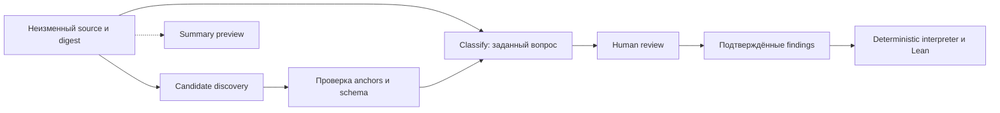

# ScaleDown CDM: применимость к NormLab

Дата проверки: 2026-10-14, Europe/Moscow (2026-10-13 UTC).
Canonical task: <https://github.com/SoundBlaster/NormLab/issues/94>.
Исследованный код: `7843936f44ad794860edcbea928a5199bf42fe30`.
Scope: документация поставщика, публичные страницы и чтение кода; inference,
установка моделей, реализация adapters и запуск tests не выполнялись.

## Решение

**Classify заслуживает отдельного bounded pilot как альтернативный verifier.
Extract — следующий кандидат для source-span discovery. Summarize пока имеет
смысл только для вспомогательного preview.** Ни одна модель не получает права
подтверждать findings или заменять формальное ядро.

Сложность исследования — medium; интеграция Classify — ориентировочно medium,
полноценная замена discovery через Extract — high из-за semantic alignment.
Это инженерная оценка scope, не измеренная трудоёмкость.

Проверены четыре вопроса: что действительно обещает API; какие ошибки NormLab
модель потенциально исправляет; что потребуется от adapter; какой эксперимент
позволит принять или отвергнуть подход. Положительного результата на данных
NormLab пока нет.

## Что означает CDM и что скрывает краткий анонс

В этом анонсе CDM — семейство продуктов ScaleDown. Ограничение результата
заданными labels/spans отличается от одного лишь принуждения генератора к JSON:
первое ограничивает пространство ответа, второе — его синтаксис. Оба допускают
семантически неверный выбор.

[FAQ ScaleDown](https://scaledown.ai/#pricing), проверенный в браузере,
называет Classify/Extract/Compress encoder-only, но прямо указывает generative
step у Summarize. Следовательно, утверждение «все три обходятся без генерации»
не соответствует текущему описанию самого поставщика. Бесплатный output —
тарифное условие, не доказательство отсутствия decoder.

| Claim анонса                      | Что проверено                                                                                   | Следствие для NormLab                                                            |
| --------------------------------- | ----------------------------------------------------------------------------------------------- | -------------------------------------------------------------------------------- |
| 1M multimodal input               | На публичной pricing page указано 1M; documents читаются в текст/OCR                            | Не отменяет application caps и не подтверждает качество на длинных RU документах |
| $0.05/M, output free              | Direct pricing: text $0.05/M, image $0.15/M; output free                                        | Считать billed input, включая повторную обработку и дополнительные passes        |
| 200× faster, 467× cheaper         | Это vendor headline; в task tables иные коэффициенты                                            | Нельзя использовать эти числа как прогноз для нашего pipeline                    |
| 77.2% DecisionBench vs Jev 72%    | В изученных первичных benchmark pages не найден воспроизводимый protocol именно этого сравнения | Не установлено, какая версия Jev, split, prompts и calibration использованы      |
| calibrated probabilities + reason | Вероятности доступны; reason не является независимой проверкой                                  | Calibration на RU legal narratives предстоит измерить                            |
| summary до 1,000 tokens           | Direct API подтверждает cap, но OpenRouter catalog указывает 4,000                              | Лимит зависит от route; до проверки выбирать консервативный direct contract      |

Источники: [pricing/FAQ](https://scaledown.ai/#pricing),
[benchmark tables](https://docs.scaledown.ai/benchmarks/providers),
[Summarize API](https://docs.scaledown.ai/api-reference/summarize),
[OpenRouter Summarize](https://openrouter.ai/scaledown/summarize/).
Акция 50M бесплатных tokens видна на сайте, но не определяет приоритет и не
авторизует отправку данных. Все тарифы — snapshot даты проверки.

[Методика ScaleDown](https://docs.scaledown.ai/benchmarks/methodology) использует
CLINC OOS/accuracy для Classify, CUAD/F1 для Extract, QMSum/ROUGE-L для Summarize,
FinanceBench/F1 для Compress. Это полезные внешние ориентиры, но они не измеряют
наш critical-error-free whole-case score. Например, ROUGE-L не устанавливает
сохранение отрицания или правильного источника утверждения. Таблица поставщика
против среднего OpenAI lineup сообщает ускорение 2.6× для Classify, 3.3× для
Extract и 2.7× для Summarize; это тоже vendor measurements, не наш benchmark.

## Где модели могут помочь

Текущий [hosted pipeline](../server/hosted-extraction.ts) сначала получает
дословные assertions с subject/episode/speaker, проверяет привязку к source,
затем классифицирует их по 15 predicates. TypeSafe path задаёт четыре состояния:
`asserted`, `denied`, `unknown`, `unsupported`. Все результаты остаются
`origin=model, decision=pending`.

| Модель    | Предлагаемая роль                                                                                       | Чего она сама по себе не доказывает                                                    |
| --------- | ------------------------------------------------------------------------------------------------------- | -------------------------------------------------------------------------------------- |
| Classify  | Fixed-label stance; проверка совместимости candidate с source; позднее отдельные attribution/scope axes | Истинность событий, полноту discovery, корректность правового вывода                   |
| Extract   | Поиск candidate spans: утверждения, участники, даты, номера и указатели attribution                     | Coreference, принадлежность vehicle/episode, speech-act scope, полноту required claims |
| Summarize | Обзор документа для навигации reviewer с доступом к оригиналу                                           | Сохранение всех исключений, неизвестности и конфликтующих позиций                      |

Пример: «Водитель отрицает, что сообщил инспектору об оплате». Найти span
«об оплате» недостаточно, чтобы поставить `payment=denied`: отрицается speech
act, а не обязательно событие оплаты. Аналогично, слова «неизвестно, оплатил ли»
не равны отсутствию упоминания; сообщение другой стороны не становится фактом
от лица narrator. Это непосредственно связано с
[каталогом ошибок](PIPELINE_ERROR_CATALOGUE.md).

Рекомендуемая граница интеграции:

При первом сравнении discovery остаётся одинаковым у обоих provider arms.
Замена discovery и verifier одновременно не позволит понять причину изменения.

## Classify: близкий semantic contract, но не замена URL

[Decisions overview](https://docs.scaledown.ai/api-reference/decisions-overview)
описывает `/v1/scaledown` с `choice`, `noul`, `score`, моделями `classify` и
`classify-1`. Каждый вопрос обрабатывается отдельно, usage суммируется;
обрабатываются `state.text`/`state.document`, а не произвольные поля state.
Для reproducibility выбирать versioned alias и фиксировать дату/route:
возвращаемое имя само по себе не является immutable weights revision.

Сопоставление с [InferenceProviders](../server/inference-providers.ts),
[HTTP transport](../server/inference-http.ts) и hosted pipeline выявило gaps:

1. Наш `state` — массив fragments с attributes. Требуется явная сериализация
   всего нужного контекста в `state.text`, с сохранением IDs и query frame.
2. Direct Decisions документирует `x-api-key`; наш transport использует Bearer.
   Поддержка Bearer у Chat Completions не доказывает её для Decisions.
3. Модель должна быть `classify-1`, provider provenance — ScaleDown. Нельзя
   оставлять Jev alias или приписывать результат TypeSafe только из-за API family.
4. Нужны точное соответствие question IDs, valid probability vectors, отказ
   при missing/extra answers и сохранение failures/unknown usage. Нынешние
   validators можно использовать как требования, не ослабляя их ради поставщика.

[Custom Classify API](https://docs.scaledown.ai/api-reference/classify) имеет
single-label и independent multi-label режимы; их scores нельзя валидировать
одинаково. Документированы 20 labels, 16 в multi-label, до 50 chunks с общей
rubric. `reasoning=true` по умолчанию запускает второй вызов; его input имеет
множитель тарифа 2×. Это объяснение уже выбранного label. Для первого pilot
оно не нужно. Direct Decisions его не возвращает.

Наш hosted batch содержит до 8 fragments × 15 predicates = 120 вопросов.
Передача одного общего state не означает единственную оплачиваемую обработку.
Если каждый вопрос читает условные 2,000 tokens, один такой batch даёт порядка
240,000 input tokens, или $0.012 при $0.05/M, ещё до дополнительных instructions.
Это расчёт по допущению, не измеренный usage; batching strategy требует отдельного
контроля. Не переносить стоимость одного короткого Classify call на весь pipeline.

## Extract: важны occurrence semantics и offsets

[Extract API](https://docs.scaledown.ai/api-reference/extract) использует Chat
Completions и специальный extraction response. Наш Responses adapter требует
другую wire shape; JSON Schema в запросе не делает их взаимозаменяемыми.

Ключевые ограничения документации:

- Flat scalar extraction возвращает максимум 10 distinct values на type;
  повторное значение остаётся только в первом occurrence.
- Nested/array outputs ограничены 200 items; их anchoring нельзя автоматически
  считать эквивалентным flat entity spans.
- Поля `start/end` названы character offsets, но Notes определяет byte positions.
- Enum/oneOf поля идут в classifier: их `text` может быть label, а offsets —
  evidence; при отсутствии evidence возможны нули и пустой context.

Для NormLab это означает отдельный adapter и явное различие `verbatim span` /
`inferred label`. Текущий JS pipeline использует UTF-16. На русском тексте
UTF-8 bytes, Unicode code points и UTF-16 indices нельзя смешивать. До live
semantic scoring нужны probes с кириллицей, emoji, combining marks и повторными
цитатами. При неизвестной системе offsets результат не принимается как anchored.
OCR text должен иметь собственный digest и связь с исходным документом: offset
в OCR не является координатой в PDF.

Для repeated claims из разных episodes distinct-value dedup особенно опасна.
Даже `threshold=0` не отменяет limits/dedup. Поэтому Extract пока оценивается как
candidate-span proposer; omissions проверяются полным source-level review.

## Summarize и контекст

[Direct Summarize](https://docs.scaledown.ai/api-reference/summarize) делает
abstractive rewrite; `finish_reason=length` указывает обрезанный результат.
Использовать summary как единственный source для verdict не предлагается:
краткий пересказ может убрать необходимую оговорку или альтернативную позицию.
Если summary используется для navigation, ссылка ведёт к оригиналу, а review
и scoring продолжают читать оригинал. Compress аналогично требует отдельной
проверки сохранения evidence; 1M context не делает её ненужной.

## Deployment, данные и неизвестные факты

На [сайте поставщика](https://scaledown.ai/#pricing) заявлены self-hosting по
enterprise license, zero retention и отсутствие обучения на пользовательских
данных. Это не найденные публичные weights и не подтверждённая возможность
запуска на нашем Mac. [Privacy Policy](https://scaledown.ai/privacy) имеет
дату 2026-06-03 и общий срок хранения personal information; из неё нельзя
вывести точные условия prompt retention для каждого route.

До production нужны актуальные условия для выбранного account/region,
API payload retention, OCR subprocessors, лицензия self-hosting при её выборе
и end-to-end policy посредника. OpenRouter integration не подтверждает поддержку
на CoreInfra. Публичный каталог не подтверждает доступность нашего account.
В этом исследовании ключи не читались, тексты проекта поставщику не отправлялись.

Не установлены: RU domain quality, local calibration, long-context completeness,
воспроизводимость DecisionBench claim, weights/model revision и работа exact
route с нашим capture contract. Это ограничения выводов, не заявленные дефекты модели.

## Предложение bounded pilot

Это **проект протокола**, не разрешение dispatch и не изменение frozen S1.3.
Главная гипотеза: Classify-1 уменьшит стоимость и latency проверки candidate
при не худшем обнаружении critical semantic defects, чем текущий baseline.

| Фаза             | Действие                                                                                          | Проверяемый результат                                                                 |
| ---------------- | ------------------------------------------------------------------------------------------------- | ------------------------------------------------------------------------------------- |
| 1. Contract      | Отдельный versioned ScaleDown adapter; подготовить synthetic fixtures для auth/state/usage/errors | Fail-closed mapping; raw capture и replay сохраняют исходный ответ                    |
| 2. Compatibility | После отдельного разрешения до 8 synthetic requests суммарно на выбранных routes                  | Подтверждены actual model/route, contract, usage и deadlines; не quality              |
| 3. Paired pilot  | 32 S1.3 candidates, два provider arms, три repeats; frozen binary Choice task C                   | 192 semantic requests, один вопрос в каждом, одинаковые source/candidate/instructions |
| 4. Review        | Paired errors/rescues, uncertainty, latency/cost и go/no-go                                       | Решение continue/reject/inconclusive; Extract — только отдельный последующий ablation |

Контроль — один заранее закреплённый доступный Jev или Luna route; выбор до
dispatch. Оба arms повторяются в одном execution window с перемешанным порядком.
Нельзя сравнивать новый короткий prompt со старым whole-pipeline score.
Это новый provider comparison на task C, а не исследование decomposition effect.

Источники берутся из [S1.3 contract](S13_OFFLINE_CONTRACT.md): 16 development
sources и 32 candidates. Human adjudication именно выбранных whole-task labels
нужна перед semantic выводом. Existing candidate labels позволяют лишь diagnostic
agreement. [Issue #64](https://github.com/SoundBlaster/NormLab/issues/64) относится
к внешнему corpus и не adjudicates этот набор автоматически.

Предлагаемые caps: 200 HTTP attempts вместе с compatibility, zero retries,
8,192 input tokens на question, 2M total input tokens, 60 секунд на attempt,
30 минут wall-clock, concurrency максимум 2, общий денежный ceiling $1.
Стоимость baseline и возможность соблюсти cap проверяются до авторизации.
Для 96 ScaleDown semantic calls теоретический input ceiling даёт около $0.0393
по direct text price; это не полный бюджет двух arms и не счёт поставщика.
При невозможности ограничить неизвестную стоимость dispatch не начинается.

Stopping rule: немедленно остановить новые dispatches при model/route mismatch,
потере source binding, недостоверном usage, превышении cap или трёх подряд
transport/contract failures. Сохранить все завершённые и незавершённые attempts;
не компенсировать failures сменой модели. Unknown billable outcome остаётся
unknown; reference не меняется по model outputs.

Метрики: false acceptance критических defects, false rejection корректных
candidates, попарные rescues/regressions по source, valid-response coverage,
repeat stability, p50/p95 latency, billed tokens/cost. При наличии независимых
labels — Brier score и reliability bins; 16 cases слишком мало для уверенного
вывода о calibration. Repeats не считаются независимыми observations.
Whole-source completeness остаётся отдельным результатом.

Предварительный go/no-go: продолжать только при отсутствии новых critical false
acceptances относительно baseline в этом reviewed наборе, contract coverage не
ниже baseline и минимум 2× улучшении cost или p50 latency без ухудшения другого
показателя. Порог — предложение для preregistration; это не доказательство
статистической non-inferiority. Иначе reject/inconclusive с разбором ошибок.

## Evidence и следующий ход

Выполнено чтение актуальных API/FAQ/benchmark pages, сопоставление с кодом,
проверка Issues и открытых PR. Исходный worktree был чистым, открытых PR на момент
проверки не было. GitHub Project запрос отклонён из-за отсутствия `read:project`;
status этой работы ведётся в Issue body по существующей практике repository.
Tests, builds, inference и deployment не выполнялись. Publication и проверки
самого документа фиксируются в Issue/PR отдельно.

Следующий ход: согласовать предложенный Classify-only contract pilot и его
reference scope; затем реализовать отдельный offline adapter. Existing
[S1.3 live task](https://github.com/SoundBlaster/NormLab/issues/67) и
[local-model research](https://github.com/SoundBlaster/NormLab/issues/73)
не возобновлены и не закрыты этим исследованием.
