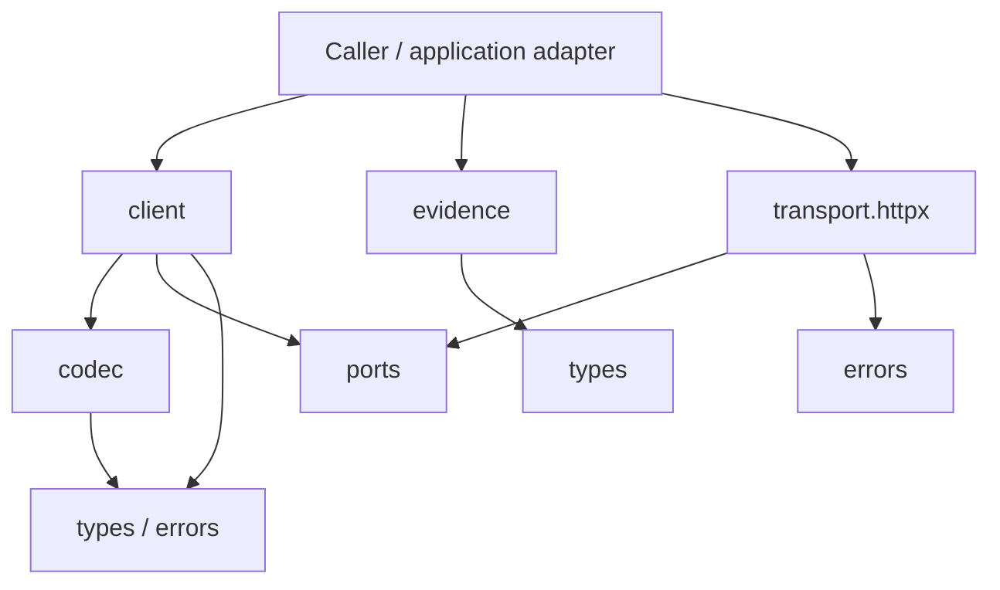

# Proposal: независимый Clairic client для Python

Дата: 2026-10-20; уточнение порядка работ: 2026-10-21.
Статус: архитектурный proposal; reusable package не реализован.
Ledger: [Stage 1 synthesis / #70](https://github.com/SoundBlaster/NormLab/issues/70).
Связанный [экспериментальный proposal](../roadmap.md#proposal-clairic-как-extractor--2026-10-20)
определяет гипотезу пользы для NormLab; этот документ определяет границу модуля.

## 1. Решение, предлагаемое к принятию

Если bounded pilot подтвердит пользу и будет отдельно разрешена разработка
reusable client, использовать один небольшой Python package с внутренними микромодулями:
типы, transport port, HTTP implementation, wire codec, client и evidence checks.
Каждая часть имеет явную ответственность и направление импортов. Отдельные
PyPI-пакеты, сервисы и независимые версии для этих частей не нужны.

Reusable module не импортирует NormLab, его ontology, Lean, evaluation harness,
Mellea или Jev4Mellea. Имена полей и инструкции получает от caller как данные.
Политики предметной области живут у caller и не становятся defaults модуля.
Передача юридического текста как входных данных допустима; включение юридических
типов, prompts и правил в библиотеку — нарушение границы.

**Пилот не зависит от создания package.** Его первый путь — минимальный
application adapter внутри существующего capture/replay harness. Он переводит
заданный request в один разрешённый HTTP attempt и возвращает исходный ответ,
operational status и provenance в существующий capture contract. Достаточен один
sync path; typed field validation и source checks выполняются в объёме,
необходимом для frozen protocol. Adapter не объявляется public library/API.

Условный namespace будущего reusable client — `clairic_client`; имя дистрибутива
и его доступность пока не проверены. Только после положительного решения по
пилоту и отдельной задачи package можно разместить в
`integrations/clairic/python/`, с `pyproject.toml` и `src/clairic_client/`.
Это предлагаемая структура следующего этапа, а не prerequisite эксперимента.
Sync/async parity, optional extras, static dependency enforcement, neutral
portability scenarios и публикация не входят в подготовку пилота.

## 2. Микромодули и зависимости

Этот раздел задаёт целевую архитектуру будущего package после pilot go/no-go;
он не является acceptance checklist минимального adapter для эксперимента.

| Микромодуль          | Ответственность                                                            | Допустимые внутренние зависимости   |
| -------------------- | -------------------------------------------------------------------------- | ----------------------------------- |
| `types.py`           | Field specs, typed answers, source/span metadata, usage, extraction result | Нет                                 |
| `errors.py`          | Public operational/protocol error taxonomy                                 | Нет                                 |
| `ports.py`           | Sync/async transport protocols; HTTP request/response envelopes            | Нет                                 |
| `codec.py`           | Проверка запроса и перевод Clairic JSON ↔ typed DTOs                       | `types`, `errors`                   |
| `transport/httpx.py` | HTTP, TLS, timeout, connection lifecycle; реализация port                  | `ports`, `errors`                   |
| `client.py`          | Один extraction call: encode → transport → decode                          | `types`, `errors`, `ports`, `codec` |
| `evidence.py`        | Чистые проверки source slice, координат и source identity                  | `types`                             |
| `__init__.py`        | Короткий стабильный public API                                             | Выбранные exports core              |

Таблица задаёт разрешённые внутренние импорты, а не обязательный импорт каждой
ячейки. Standard library доступна всем; `httpx` разрешён только HTTP implementation.
Предлагаются standard-library dataclasses/typing для core DTOs. Pydantic не
нужен как обязательная зависимость первого варианта.



Client зависит от transport protocol, а не от `httpx`. Сборку конкретного
client делает composition root потребителя. Один DTO не должен импортировать
client ради метода, сети или настройки окружения. HTTP implementation не знает
о `fields`, ontology или правилах допуска результатов.

Первый HTTP adapter подключается через optional extra `[httpx]`; импорт core
не требует его установки. Credentials передаются явно и не читаются из
окружения при импорте. Env/config loading выполняется приложением.

## 3. Transport и wire contract

- Transport получает method, абсолютный endpoint, headers, bytes и timeout;
  возвращает status, headers и bytes. Он не разбирает Clairic JSON.
- Codec знает provider wire format, в том числе HTTP envelope Cloudflare;
  client использует явно выбранный wire profile. Наличие `endpoint_url` само
  по себе не означает совместимость произвольного proxy.
- Первый profile — официальный Workers AI REST endpoint. Custom gateway с
  другим envelope требует явного codec/profile и контрактных fixtures.
  Автоматического угадывания формата ответа нет.
- Endpoint, credential и timeout задаются независимо. Нельзя пересылать credential
  при redirects на другой origin; redirects по умолчанию выключены.
- Default — один HTTP attempt на `extract()`, без скрытых retries, fallback,
  chunking или дополнительных LLM-вызовов. Caller управляет budget и retries.
- Sync/async public clients имеют одинаковую семантику и общий codec. Внутри
  async API нет блокирующего HTTP и `asyncio.run()`; cancellation передаётся caller.
- Ownership transport явное: переданный transport закрывает caller. HTTP adapter
  поддерживает context manager / async context manager.

Разделять `ConfigurationError`, `AuthenticationError`, `RateLimitError`,
`TransportError`, `ProviderError` и `ProtocolError`. `Retry-After` и доступные
request IDs сохраняются как диагностика, но не запускают retry автоматически.
Timeout после отправки может иметь неизвестный результат и usage: это не
доказательство, что provider ничего не вычислил или не списал.

## 4. Типы и сохранение evidence

Минимальный поддерживаемый subset первого client: `text`, `number`, `date`,
`list` с явно поддержанными item types из закреплённой schema. Ответы разбираются
как union по `type`, с проверкой соответствия requested field и response variant.
Неподдерживаемые типы отклоняются до HTTP; новый provider variant даёт явную
ошибку с сохранённым безопасным evidence, а не молчаливое приведение к text.

| Результат      | Что сохранять                                                          | Чего не выводить автоматически                                |
| -------------- | ---------------------------------------------------------------------- | ------------------------------------------------------------- |
| Text           | `value`, provider span, `p_null`, `confidence`, `guess` по wire schema | Что `guess` заменяет `null`                                   |
| Number / date  | Typed value и доступные uncertainty metadata                           | Что значение имеет text span или прямо процитировано          |
| List           | Элементы и доступные spans/confidence по schema                        | Что отсутствующие `p_null` или per-item confidence равны нулю |
| Whole response | Raw body, model, `truncated`, usage, доступные request IDs             | Что один HTTP call равен одному provider pass                 |

Ответ `value: null` не равен operational failure. Отсутствующий required answer
не равен корректному `null`. Пустой list не означает отрицание существования
объекта. Диагностические span/guess при `null` не становятся accepted evidence.
Confidence — provider metadata, не независимое подтверждение точности.

Requests и results несут локальную source identity: digest точного UTF-8 ввода
и версию определения digest. Это caller-side provenance, не подпись provider.
Отдельно сохраняются requested model и реально возвращённый model; отсутствующие
данные не восстанавливаются догадкой. Raw body доступен для capture/replay,
но не пишется в файл или log автоматически. Ключи и Authorization не входят
в repr/error/evidence; хранение исходных текстов и raw responses выбирает caller.

`estimate`/`forecast`, изображения и computation-сценарии вне первого subset.
При этом `number`/`date` сами по себе не гарантируют extraction вместо computation:
инструкции и проверка происхождения значений остаются явными. Client не заявляет,
что способен механически доказать способ получения числа моделью.

## 5. Source checks без предметной политики

`evidence.py` предлагает детерминированные операции:

1. Проверить source identity и границы span.
2. При явно установленной coordinate system выделить точный source slice.
3. Сравнить slice с non-null text value без нормализации исходного текста.
4. При необходимости caller преобразовать координаты в Python code points,
   UTF-8 bytes или UTF-16 code units с проверкой допустимых границ.
5. Вернуть структурированные findings: match, mismatch, invalid bounds,
   unknown coordinate system, unavailable evidence или truncated response.

Исходные provider coordinates сохраняются отдельно от производных. Пока единицы
и end convention не установлены документацией/контрактной проверкой, результат
проверки — unknown; подбирать систему по «подходящему» вхождению нельзя.
Разрез surrogate pair или многобайтового символа недопустим. Source text не
переписывается; если provider возвращает `state_text`, отличие от отправленного
текста не скрывается и требует явного выбора basis или unresolved finding.

Для number/date можно отдельно запросить companion text field. Проверка того,
что значение действительно следует из этой цитаты, требует отдельного parser
или policy caller. Совпадение text span не подтверждает actor, episode,
speaker, polarity или правильность юридического вывода.

Findings описывают технические свойства evidence. Решение accept/review/reject,
порог confidence и дальнейший LLM-вызов задаёт приложение. Модуль не включает
скрытую «юридическую валидацию» или автоматическое исправление текста.

## 6. Application adapter и Mellea

Пример разделения для NormLab:

```text
NormLab definitions / source text
  → generic ExtractionRequest
  → Clairic client
  → generic ExtractionResult + evidence findings
  → NormLab participant/source/episode binding
  → classification → human confirmation → deterministic calculation
```

Слова «парковка», «ТС», статьи, санкции, гипотезы и подтверждение пользователем
находятся только в application adapter и fixtures NormLab. В reusable package
нейтральные примеры: документы, товары, даты и контакты.

Jev4Mellea продолжает обслуживать decision tasks. Добавлять extraction в его
categorical DTOs через фиктивные labels или confidence не предлагается.
Mellea wrapper сначала можно держать у потребителя: он вызывает client и
применяет явно заданные checks/policy. Optional `[mellea]` bridge в отдельном
модуле возможен при втором доказанном сценарии; core от него не зависит.
В этом proposal не заявляется совместимость с конкретным Mellea API.

## 7. Этапы и критерии review

### A. Принять архитектурную границу

- [ ] Согласованы один package, микромодули и разрешённые импорты.
- [ ] Определены neutral public DTOs и граница application adapter.
- [ ] Зафиксированы wire profile, поддержанный subset и открытые вопросы offsets.

### B. Проверить гипотезу в существующем harness

Это следующий экспериментальный этап, отдельно разрешаемый bounded protocol,
а не реализация package из разделов 2–6:

- [ ] Заморозить минимальный request/response contract, fixtures, comparison arms
      и caps; проверить representability и неизвестные offsets по roadmap.
- [ ] Добавить только необходимый application adapter в существующий harness:
      один sync call, parsing используемого subset, operational errors,
      credential redaction и сохранение исходного response/provenance.
- [ ] Offline-проверкой покрыть фактически используемый contract и guards;
      полная package-level matrix не является prerequisite этого этапа.
- [ ] Выполнить отдельно согласованный
      [bounded pilot](../roadmap.md#proposal-clairic-как-extractor--2026-10-20)
      с существующими capture/replay/scoring. Внешние caps, retries, все вызовы,
      стоимость и human review остаются условиями его protocol.
- [ ] Зафиксировать go/no-go по пользе для pipeline. Один успешный HTTP call
      подтверждает доступность; smoke или source-boundary diagnostic не заменяет
      сравнительный пилот и не подтверждает semantic quality.

При no-go сохранить evidence и defer reusable package. Отдельного
инфраструктурного этапа перед пилотом нет. Этот proposal сам не разрешает
implementation, новые tests или inference.

### C. После pilot go — отдельная задача reusable client

Только после положительного решения этапа B и отдельного разрешения:

- [ ] Core импортируется без HTTP/Mellea и без доступа к окружению/сети.
- [ ] Static import/dependency checks отклоняют циклы, обратные зависимости,
      domain imports и imports `httpx` вне HTTP adapter.
- [ ] Offline fixtures покрывают per-type parsing, null/guess, missing fields,
      unsupported types, truncation, malformed responses и operational errors.
- [ ] Unicode fixtures: кириллица, emoji, combining marks, повторные цитаты,
      границы координат; неизвестные единицы остаются unknown.
- [ ] Fake transport проверяет один attempt, timeout/cancellation, credential
      redaction и transport ownership без provider calls.
- [ ] Sync/async public clients и optional HTTP extra соответствуют разделам 2–3.
- [ ] Два нейтральных сценария используют тот же client без NormLab imports.

Это будущие package acceptance criteria. Они не блокируют B и не считаются
выполненными из-за smoke/пилота. Код и перечисленные tests в этом PR не добавляются.

### D. Решить о самостоятельной публикации

Выделять repository/distribution после полезного пилота, стабилизации контракта
и проверки переносимости на этапе C. Публикация необязательна для эксперимента.
До неё выбрать имя/лицензию, зафиксировать Python compatibility и отдельно
проверить условия provider. Лицензия client не предоставляет права на модель.

## 8. Источники и открытые вопросы

- [Clairic model/API reference](https://developers.cloudflare.com/workers-ai/models/clairic/)
  — hosted preview, request/response examples и различия metadata.
- [Extraction models](https://developers.cloudflare.com/workers-ai/concepts/extraction-models/)
  — различия extraction/computation/estimation, null и ограничения uncertainty.

API reference проверена 2026-10-20 при подготовке исходного roadmap proposal.
Декомпозиция Python package и его public API здесь — проектное предложение,
а не описание официального Cloudflare SDK.

Перед реализацией уточнить точную wire schema/envelope и offset convention;
перед live-пилотом — доступ, auth и caps. CoreInfra compatibility не подтверждена.
Ни доступность модели, ни выигрыш на русских фабулах этим документом не доказаны.
