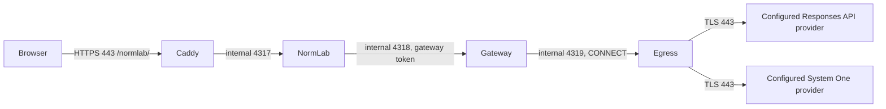

# Hosted inference preparation

Prepared 2026-10-07. Code/configuration readiness is separate from deployment,
provider-account availability, regional support and extraction quality. No live
keys were read or installed and no paid inference was run during preparation.

## Runtime

The container image now contains native TypeScript adapters for
[OpenAI Responses structured output](https://developers.openai.com/api/docs/guides/structured-outputs)
and [TypeSafe System One Choice](https://docs.typesafe.ai/api). It does not need
Python, LM Studio or LangExtract for this hosted path. The local Python v3
evaluation path remains selectable with `NORMLAB_INFERENCE_MODE=local`.
Production defaults to `disabled`; opt-in configuration selects `gateway`.

Only the existing Caddy ingress publishes a port. Gateway and egress are separate
processes from the same digest-pinned NormLab image in the existing VPS Compose
project. They are not separate Timeweb App Platform applications.

## Secret inventory (fixed VPS locations)

The dedicated host directory `/srv/0al/secrets/normlab-inference` belongs to root
with mode `0700`. Files belong to UID/GID `1000:1000` with mode `0400` (read-only
Compose bind mounts preserve host ownership/mode). No values go into `.env`.

| Credential | Host file | Container file | Consumers |
| --- | --- | --- | --- |
| OpenAI API key | `/srv/0al/secrets/normlab-inference/openai-api-key` | `/run/secrets/normlab_openai_api_key` | Gateway only |
| TypeSafe API key | `/srv/0al/secrets/normlab-inference/typesafe-api-key` | `/run/secrets/normlab_typesafe_api_key` | Gateway only, TypeSafe overlay |
| Internal random token | `/srv/0al/secrets/normlab-inference/gateway-token` | `/run/secrets/normlab_inference_token` | NormLab and gateway |
| Existing operator password | `/srv/0al/secrets/normlab-operator-password` | `/run/secrets/normlab_operator_password` | NormLab only |

`NORMLAB_OPENAI_API_KEY_FILE`, `NORMLAB_TYPESAFE_API_KEY_FILE` and
`NORMLAB_INFERENCE_TOKEN_FILE` contain the corresponding container paths.
Startup rejects missing, oversized, empty, non-absolute or broadly readable
secret files. Credentials must contain at least 32 printable non-whitespace
ASCII characters; one trailing newline is supported. Compose file secrets are
protected host files, not an encrypted external vault. Docker/root retains access.

Provider keys and the gateway token never appear in request artifacts or logs.
The browser calls NormLab only. The gateway inserts each provider key into its
own outbound Bearer header. Registry/GitHub credentials have no role here.

## Provider addresses (operator configuration)

| Setting in gateway and egress | Default API base | Fixed resource |
| --- | --- | --- |
| `NORMLAB_OPENAI_BASE_URL` | `https://api.openai.com/v1` | `/responses` |
| `NORMLAB_TYPESAFE_BASE_URL` | `https://api.typesafe.ai/v1` | `/systemone` |

An API base includes its complete path prefix; an optional trailing slash is
removed. The user-supplied CoreInfra base
`https://hub.coreinfra.ai/codex/api/v1` yields exactly
`https://hub.coreinfra.ai/codex/api/v1/responses`, preserving `/codex/api` and
adding no second `/v1`. It replaces the direct-OpenAI destination. Addresses
are non-secret deployment settings, never browser inputs. Startup rejects HTTP,
IP literals, single-label hosts, non-443 ports, userinfo, queries, fragments and
ambiguous paths. The gateway and egress independently parse the same two values;
the proxy allowlist derives only their exact DNS authorities on port 443.

Recreate **both** services after changing an API base: mismatched settings fail
closed. NormLab does not receive provider addresses or keys. Replace the
corresponding secret with that supplier's key when changing suppliers; never
put it in a URL. Secret paths/mounts stay unchanged. Each inference call records
its validated endpoint, requested model and resolved model, identifying the
actual supplier even when API-family labels (`openai`/`typesafe`) match.

The OpenAI slot requires Responses API compatibility: Bearer auth, non-streaming
JSON responses, `store:false`, reasoning settings and strict `text.format` JSON
Schema. It does not implement Chat Completions or SSE-only backends. The TypeSafe
slot retains the System One Choice contract. A different URL alone does not
establish API/model/account compatibility. OpenAI-compatible model aliases may
include a vendor prefix such as `vendor/model`; use a supplier-confirmed name.

Preparation probe on 2026-10-07: unauthenticated GET of CoreInfra's Responses
path returned HTTP 404. No key or narrative was sent. This does not establish
whether authenticated POST supports the required contract.

## Exact network paths and enforcement

| Source | Destination | Allowed operation |
| --- | --- | --- |
| Authenticated browser | `https://managed.specgraph.tech/normlab/api/parking/extract` | Existing POST, operator authentication + Origin + CSRF |
| NormLab | `http://normlab-inference-gateway:4318/v1/extract` | Authenticated POST with narrative and source digest only |
| Gateway | `http://normlab-inference-egress:4319` | CONNECT to exactly two configured DNS authorities on port 443 |
| Gateway via TLS tunnel | Responses API base + `/responses` | POST for discovery and optionally classification |
| Gateway via TLS tunnel | System One API base + `/systemone` | POST for optional Jev classification |

NormLab joins the existing `normlab-private` ingress network and the new
`inference-private` network; both are internal. Gateway joins only
`inference-private` and `inference-proxy-private`, also internal. Only the
egress proxy joins `inference-egress`, a normal outbound Docker bridge.
Docker's embedded DNS resolves the two provider names through the host resolver;
the proxy needs that DNS path plus outgoing TCP 443. No incoming 4318/4319 port
is opened on the VPS, and the browser never connects to the providers directly.

The proxy rejects other domains, literal IP authorities, different ports,
plaintext HTTP and DNS answers in private/link-local/loopback ranges. It dials
the checked address without a second DNS lookup. TLS is end-to-end between
gateway and provider with normal hostname/certificate verification; the proxy
does not decrypt payloads or receive API keys. It enforces domains/port, while
the gateway adapters enforce the two API paths and fixed request shapes.
The RPC caller cannot select an endpoint, model, prompt, schema, tool or header.
Redirects are rejected; there are no retries or provider fallback.

The egress container itself is the trusted network boundary and has outgoing
network access. This is container isolation plus a proxy allowlist, not a
host firewall domain rule. Root, Docker daemon compromise or compromise of
the proxy itself are outside this boundary. New suppliers require operator
configuration review and API verification. New API protocols need adapter code;
the RPC never accepts a URL.

## Pipeline and review boundaries

`literal-discovery-then-classification/hosted-v1` is a separate candidate from
the measured Python v3. Prompts and definitions are a frozen snapshot in
`server/inference-prompts.json`. `promptDigest` hashes those prompts together with
the inline untrusted-data prefixes, Jev question template and criteria, JSON
schemas, batch size and OpenAI request settings, so any behavioural change yields a
new digest (pinned in `tests/inference.test.ts`). It, model response IDs, requested
and resolved model names, usage, responses and decisions accompany each result.
Changing transport/model or Jev's questions requires a new evaluation; previous
50%/80% goals and corpus scores do not transfer automatically.

1. OpenAI discovers literal quotations, subjects, episodes and attribution.
2. The application rejects invented or ambiguous repeated quotations. It
   computes UTF-16 offsets against the unchanged original, without normalization.
3. OpenAI classification uses batches of up to 8 fragments to bound strict
   schema/output size and requires an explicit decision for every fragment.
   Up to 3 batches run concurrently; results keep source order, and the first
   failed batch cancels the others and starts no further calls.
   Alternatively Jev answers four-option atomic questions for each of the 15
   predicates: asserted / denied / explicitly unknown / unsupported. Requests
   contain 8 fragments and up to 120 questions. The fragment ID and predicate
   appear in instructions, because TypeSafe question keys are not model input.
4. Jev probabilities/confidence remain in the artifact. Low confidence is not
   silently discarded and high confidence never confirms a fact. `valueText`
   uses the exact source quote, since Jev does not generate summaries.
5. Every resulting statement is `origin=model, decision=pending`. Human review,
   contradictions and missing facts remain separate from legal computation.

Limits: 8000 UTF-16 source units for hosted extraction (drafts still accept
32768; longer drafts are rejected before any provider call or quota use), 256
discovered fragments/statements, 2048 units per hosted quote, 16384 OpenAI output
tokens for discovery (reasoning included) and 8192 per classification batch, 120
seconds per provider call, 300 seconds per complete extraction, 4 MiB output, one active
extraction. Default quota is six attempts/hour. The quota is in-memory and
resets with gateway restart; it is not a hard billing cap. Configure a provider
project spending limit separately. No automatic retry doubles an invoice.
Invalid/empty extraction, timeout, missing fragment decisions and malformed
probabilities fail closed and preserve the saved draft revision.

Successful inference artifacts contain narrative/quotes/prompts and are saved
in the existing private NormLab data volume, separate from human revisions.
Use synthetic inputs during staging. `store:false` is requested from OpenAI;
this is not a claim of zero retention at either provider. The UI discloses the
external transmission before extraction.

## Activation and regional availability

Canonical deployment overlays and secret-install commands belong to Platform's
[inference runbook](https://github.com/0al-spec/Platform/blob/main/docs/normlab-inference-runbook.md).
Select OpenAI discovery + OpenAI classification first, or add the TypeSafe
overlay for OpenAI discovery + Jev classification. Defaults are `gpt-6-luna`
(low reasoning) and pinned `jev-1.13.0`; account access remains to be verified.

The previously supplied Timeweb server screenshot shows a Russian region.
Russia is absent from OpenAI's current
[supported countries](https://developers.openai.com/api/docs/supported-countries).
Before activation establish an eligible deployment/account arrangement with
the provider; a local egress proxy does not change the VPS region or source IP.
For a reseller such as CoreInfra, verify that supplier's supported regions,
account access and API contract separately. The direct-OpenAI regional observation
does not establish whether a reseller is available or eligible.
TypeSafe availability must also be checked against the intended account/region.
These overlays remain opt-in while that is unresolved.

Next gate: merge both PRs, publish the new immutable image, provision credentials
through the secure installation procedure in an eligible environment, then run
one synthetic case and a small fixed corpus. Health checks alone confirm only
that the processes answer, not successful provider inference or semantic quality.

## Preparation validation

On 2026-10-07, all 58 application tests passed, including 10 hosted inference
tests. TypeScript checks, format, lint/FSD, schema/reference checks and production
build passed. A Linux/amd64 image built with the pinned Lean toolchain. An
isolated local Compose smoke run used synthetic credentials and verified healthy
processes, private gateway authentication, absence of provider keys in NormLab
and egress, no published helper ports, denied direct internet access from NormLab
and gateway, and rejection of other CONNECT authorities. The three Platform
configuration/provisioning tests also passed. These checks do not establish
real credential access, regional eligibility or semantic extraction quality.
