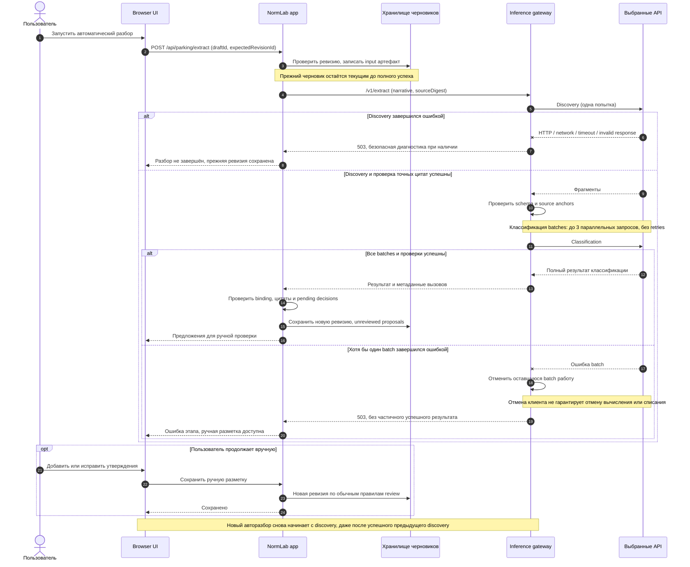
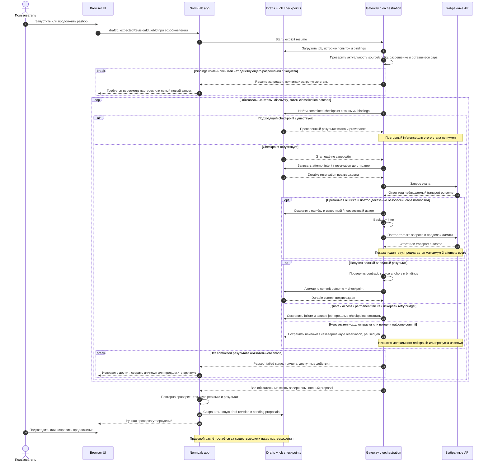

# Hosted inference: сбой и восстановление

Дата: 2026-10-21. Ledger: [#172](https://github.com/SoundBlaster/NormLab/issues/172).

**Назначение:** постоянная ссылка на последовательность действий при отказе API.
Первая диаграмма описывает исторический код до изменений, вторая — исходный proposal.
Реализация checkpoints описана отдельно ниже; automatic retries/fallback не добавлены.

После обсуждения UX начата [implementation #179](https://github.com/SoundBlaster/NormLab/issues/179).
[Журнал и явные ошибки](HOSTED_RECOVERY_UX.md) и
[реализованные app-owned jobs/checkpoints](HOSTED_CHECKPOINT_JOBS.md) развивают этот
proposal. Актуальная диаграмма находится в новом контракте: orchestration принадлежит
приложению, gateway выполняет один stage; automatic retries не реализованы.
Обе диаграммы ниже сохранены как историческое описание и исходный proposal,
а не как статус текущей реализации или deployment.

## Границы и актуальность

Текущее поведение проверено по `main` commit
[`cd5ba84`](https://github.com/SoundBlaster/NormLab/tree/cd5ba84ded0acda769f2c72ca48ce2b8f5465101).
Это чтение кода; доступность провайдеров и deployed configuration здесь не проверялись.
Discovery использует Responses; classification использует выбранный в конфигурации
Responses, TypeSafe или Decisions endpoint. На диаграммах они объединены в API.
Egress proxy и ingress опущены: сетевой маршрут описан в [runbook](HOSTED_INFERENCE.md#runtime).

Saved revision означает записанный черновик. Checkpoint в предлагаемом варианте
означает технически валидный результат этапа, **не подтверждённый человеком факт**.
Частичный результат не становится полным юридическим выводом.

## До изменений: исторический hosted path

### Что важно в текущем поведении

- Внешняя ошибка останавливает попытку разбора, а не весь NormLab.
- Нет автоматических retry, смены провайдера или пропуска обязательного этапа.
- При schema/source validation failure успешный ответ API тоже не принимается;
  применяется путь ошибки. Диаграмма отдельно показывает основной сетевой сценарий.
- Промежуточные ответы gateway находятся в памяти; при ошибке полный result не
  возвращается приложению. Нет durable checkpoints discovery/classification.
- Сохранённая ревизия остаётся доступной; это не гарантия сохранности данных при
  удалении storage или потере неперсистентного deployment volume.
- Часть параллельных запросов могла быть оплачена. Timeout или abort не доказывает
  отсутствие серверного выполнения. Нажатие «повторить» может повторно оплатить этапы.
- UI не всегда различает недостаток баланса и другие отказы: сейчас диагностика
  в основном определяется HTTP status, без полной provider-specific taxonomy квоты.

## После изменений: предлагаемый hosted recovery path

**Статус: proposal, не реализовано.** Orchestration и job/checkpoint storage ниже —
предлагаемые обязанности gateway и storage, а не существующий API или сервис.
Создание отдельного deployment/service не требуется этим proposal.

`break` означает завершение текущей попытки orchestration, а не выполнение
стрелок успешного пути ниже. После устранения причины пользователь снова нажимает
«Продолжить»: диаграмма начинается сначала с того же job, проверяет историю и
переиспользует только подходящие committed checkpoints. Изменённые bindings или
непригодное разрешение требуют отдельного явного решения о новом запуске;
история расходов не сбрасывается. Crash после checkpoint commit можно распознать
по committed записи; crash до commit не превращает orphan response в успех.

### Политика ошибок, предлагаемая для реализации

| Ситуация                                                | Действие                                                                                             | Условие продолжения                                                                                    |
| ------------------------------------------------------- | ---------------------------------------------------------------------------------------------------- | ------------------------------------------------------------------------------------------------------ |
| Временная ошибка, подтверждено отсутствие обработки     | Bounded retry того же request, backoff/jitter                                                        | Есть действующее разрешение и общий budget; максимум 3 attempts на logical request                     |
| Запрос мог быть обработан, подтверждённого outcome нет  | Paused unknown, без automatic redispatch                                                             | Authoritative reconciliation либо явное решение о новом платном запросе с сохранением прежнего unknown |
| Rate limit с подтверждённой retry семантикой            | Ограниченное ожидание с учётом Retry-After                                                           | Только если безопасно и укладывается в deadline/caps; иначе pause                                      |
| Баланс / quota исчерпаны, ключ или доступ отклонены     | Pause без автоматических retries                                                                     | Исправление доступа/баланса и explicit resume с повторной проверкой budget                             |
| Некорректный, неполный ответ или сломанные anchors      | Сохранить failure, не выдавать как успех                                                             | Ручная правка либо отдельно разрешённая новая попытка; repair не подразумевается                       |
| Провайдер закрылся окончательно                         | Остановить зависимый этап                                                                            | Явный выбор совместимого provider/config; пересмотр затронутых checkpoints                             |
| Checkpoint storage недоступен или commit не подтверждён | Без reservation commit не отправлять запрос; без outcome commit не начинать следующий зависимый этап | Сверка durable состояния; отсутствие acknowledgement не равно отсутствию commit                        |
| Пользователь выбирает ручную разметку                   | Обычный ручной путь с provenance и confirmation                                                      | Никакого скрытого AI verdict или автоматического признания пропущенного шага успешным                  |

Смена провайдера — отдельная явная policy, не automatic fallback этого proposal.
Она меняет provenance и, возможно, стратегию: переиспользование предыдущих этапов
допустимо только после проверки зависимостей. Клиент должен видеть, какой provider,
model и endpoint фактически использовались; критерии принятия результата не ослабляются.

Для reuse нужны как минимум source revision/digest, stage request/schema/prompt,
ontology/configuration и requested/returned model/provider bindings, а также
зависимости от предыдущих checkpoints. Совпадения только текста недостаточно.
Checkpoint сохраняет raw evidence и сведения о попытках; credentials в него не входят.
Сохранённый результат модели остаётся proposal до human review.

## Связь с evaluation runner и границы изменений

[Evaluation safe resume](NATIVE_SAFE_RESUME_V1.md),
[continuation consumers](CONTINUATION_CONSUMERS_V3.md) и
[unknown stop](NATIVE_UNKNOWN_STOP_V1.md) — отдельные уже реализованные contracts.
Они не делают hosted pipeline автоматически возобновляемым и не должны меняться
ради добавления этих диаграмм. Их frozen history/caps/unknown accounting полезны
как ориентир; перенос требует самостоятельного решения и проверки.

MLflow import выполняется отдельно над сохранённым evidence. Сбой импорта не
требует повторного inference: см. [offline importer](OFFLINE_MLFLOW_IMPORT_V1.md).
MLflow не включён в обязательную цепочку hosted UI на этих диаграммах.

## Карта исходников и последующий шаг

| Свойство текущего поведения                                           | Источник                                                                                               |
| --------------------------------------------------------------------- | ------------------------------------------------------------------------------------------------------ |
| Нет transport retries/fallback, timeout и безопасная HTTP диагностика | [inference-http.ts](../server/inference-http.ts), [inference-errors.ts](../server/inference-errors.ts) |
| Discovery, batch concurrency, отмена остальных batches при ошибке     | [hosted-extraction.ts](../server/hosted-extraction.ts)                                                 |
| Gateway возвращает 503 при сбое extraction                            | [inference-gateway.ts](../server/inference-gateway.ts)                                                 |
| Прежняя ревизия сохранена, ручная разметка доступна                   | [parking-review.ts](../server/parking-review.ts)                                                       |

Следующий отдельный результат — согласовать минимальный job/checkpoint contract
и UI states для этого proposal. В этом документационном PR нет runtime implementation,
новых tests, live calls или deployment; они требуют отдельных задач.
