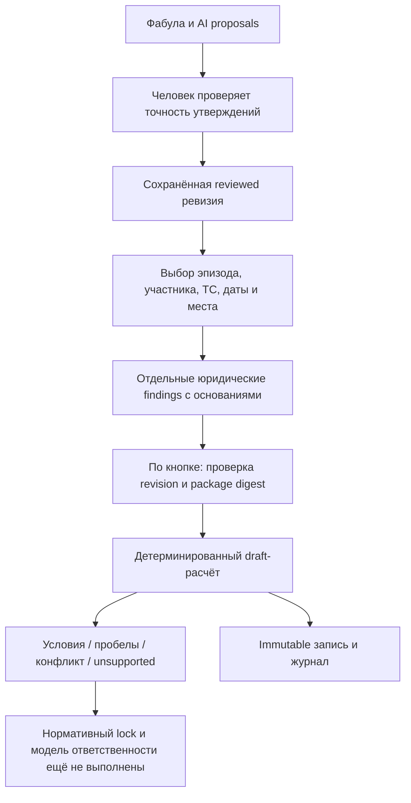

# Юридические обстоятельства и нормативный фрагмент

Дата: 2026-10-22. Задача: [#190](https://github.com/SoundBlaster/NormLab/issues/190).

## Какую норму считаем

Пилот — **часть 2 статьи 8.14 КоАП города Москвы**, Закон Москвы от 21.11.2007
№ 45. Это региональный акт. Федеральный **КоАП РФ** содержит общие положения,
которые нужны для вывода об ответственности; московская статья не становится
статьёй федерального кодекса. План интервью выбрал именно этот фрагмент.

Сейчас реализован **draft-расчёт условий фрагмента**, а не полная квалификация.
Реестр [PARKING_SOURCES.md](PARKING_SOURCES.md) ещё не закрывает нормативный lock.
Проверка текста, человеческое установление обстоятельства, проверка редакции и
доказательство вычисления — четыре разные операции.

Подготовлены [отдельный архив источников](sources/moscow-parking/2026-10-22/README.md)
и [пять планов прохождения](../fixtures/parking-pilot/walkthroughs/README.md).
Архив не изменяет identity исполняемого manifest и не закрывает нормативный lock.

## Пакет норм

Исследовательский manifest:
[norms/moscow-parking/manifest.json](../norms/moscow-parking/manifest.json).

| Слой        | Представление                                                                              |
| ----------- | ------------------------------------------------------------------------------------------ |
| Identity    | ID, semantic version, юрисдикция RU-MOW, акт и статья                                      |
| Источники   | Официальные URL, locator, вид evidence и ограничение редакции                              |
| Условия     | Stable condition IDs, вопросы, подсказки, source refs                                      |
| Границы     | Обычная городская парковка, гражданин и личный легковой автомобиль                         |
| Исключения  | Ошибки/исправления/поздняя оплата, льготы, особые тарифы и обстоятельства дают unsupported |
| Последствие | 5 000 ₽ только как санкция-кандидат исследованной редакции                                 |
| Readiness   | research-draft, currentLawVerified=false, liabilityModelComplete=false, proof=none         |
| Зависимости | Применимая редакция, действующие правила оплаты и общая часть КоАП РФ остаются открытыми   |

Существующий `normlab.norm-package/v1` и `legal-ir/v2` обслуживают synthetic
reform-D16 с M/N/E и валютой DEMO. Они не являются универсальным форматом
КоАП и не используются для представления настоящей нормы как synthetic fixture.
У парковочного draft собственный узкий контракт. Для полноценного пакета
сохраняется design [NORM_SOURCE_PROVENANCE.md](NORM_SOURCE_PROVENANCE.md):

```text
NormPackage
  manifest: jurisdiction / identity / version / readiness
  source snapshots: original bytes + extracted text + separate SHA-256
  fragments: article / part / point / exact quote / edition / effective dates
  vocabulary: concepts and links to case ontology
  rules: predicates / exceptions / consequence / formalization rationale
  dependencies: federal general provisions and municipal payment rules
  reviews: source / edition / semantics, with unresolved dependencies
```

Это структура будущего нормативно locked пакета, а не уже реализованный архив
источников. FAQ не заменяет нормативный акт, URL не заменяет snapshot, digest
не доказывает актуальность. S01/S04/S07 связаны с исследовательским реестром;
историческая редакция S04 не объявлена действующей. Сумма не назначается при
unknown/conflict/unsupported и даже при совпадении условий остаётся draft-кандидатом.

## Переход от слов к решениям



Подтверждённое «я заплатил» означает, что человек проверил корректность
разметки слов. Юридическое решение о платеже дополнительно относится к
конкретному ТС, месту и интервалу. Баланс счёта и попытка оплаты не подменяют
успешную своевременную оплату правильных реквизитов за весь интервал.

У finding пять состояний: `unreviewed`, `established`, `refuted`,
`not-established`, `conflict`. Для рассмотренного состояния обязательно
основание. Можно сослаться на подтверждённые утверждения того же эпизода
или записать собственное дополнение. Цитата сохраняет provenance, но не доказывает
истинность. Противоречащие цитаты не разрешаются автоматически: человек
сохраняет конфликт либо объясняет выбор в основании. Это не юридическая экспертиза.

Все новые findings начинаются с `unreviewed`, без переноса model decisions.
При изменении эпизода, участника, ТС, даты или места локальные findings
сбрасываются. Новая текстовая ревизия не наследует решения; старые записи
сохраняются. Вид ТС не выводится из «я припарковался»;
личный легковой автомобиль — отдельный scope gate.

## Вычисление

[shared/parking-legal.ts](../shared/parking-legal.ts) содержит чистый evaluator.

| Outcome          | Условие                                                |
| ---------------- | ------------------------------------------------------ |
| conflict         | Есть finding с конфликтом                              |
| unsupported      | Опровергнута граница поддержанного сценария            |
| incomplete       | Не рассмотрено или не установлено обязательное условие |
| fragment-refuted | Все входы рассмотрены; основное условие опровергнуто   |
| fragment-matched | Все включённые условия установлены                     |

Консервативный порядок сохраняет обязательные проверки scope даже при раннем
опровержении. Это не правило российского доказывания. При единственном открытом
условии UI показывает две гипотетические ветви на один шаг. Они не меняют findings
и не перечисляют декартово произведение неизвестных обстоятельств.

Ни один outcome не устанавливает `guilty`, полную ответственность, действующую
на дату события санкцию или Lean verification. Всегда сохраняются
`normativeStatus=research-draft`, `liability=not-assessed`, `proof=none`.
Пользователь не может снять нормативный gate подтверждающей галкой.

Упомянутый штраф сравнивается только с доступным draft-кандидатом:
draft-match / draft-difference / not-computable. Это не проверка постановления.

## API, хранение и актуальность

- `GET /api/parking/legal/:draftId` возвращает manifest, его SHA-256 и историю.
- `POST /api/parking/legal` принимает только входы, action save/calculate,
  ожидаемые revisionId / assessmentId / packageDigest и requestId.
- Сервер проверяет current reviewed ревизию, checklist, metadata, эпизод и ссылки.
  Клиент не присылает результат или подменённый пакет.
- Сохранение и расчёт — одна immutable запись в
  `parking-review/<draftId>/legal/<requestId>.json` с mode 0600: actor, время,
  sequence, source digest, точные входы, snapshot manifest и результат.
- Незаполненные дата, интервал, место, участник или ТС сохраняются как пробелы и блокируют совпадение фрагмента. Некорректная непустая дата отклоняется.
- Один requestId с теми же входами возвращает прежнюю запись. Другие входы с тем
  же ID отклоняются. При неизвестном сетевом исходе UI предлагает повтор именно
  этого запроса; автоматического повтора нет.
- Пока есть несохранённые юридические правки, выполняющийся запрос или неизвестный
  исход сохранения, родительский экран блокирует смену черновика/ревизии и правки
  исходной разметки. Сам редактор обстоятельств остаётся доступен для сохранения,
  повтора прежнего запроса либо явной отмены правок с подтверждением. Неизвестный
  запрос нельзя потерять обычным переключением.
- Optimistic assessmentId предотвращает тихое перетирание из другой вкладки.
  Записи дают события в общем журнале. Ошибка не превращается в успех.
- Результат показывается как старый при локальных правках, непроверенном тексте
  или неподтверждённом сохранении. История другой ревизии отдельно обозначена;
  её findings не становятся новыми принятыми входами.

Хранилище — private single-user demo, без подписанной квитанции и отдельной
защиты от изменения файлов администратором. Reader проверяет bindings и пересчёт
для единственной поддержанной версии. Изменение семантики требует новой версии
и reader/replay для исторических пакетов; тихая миграция результатов запрещена.

## Следующий gate

Для правового вывода нужно закрыть snapshot/edition lock, проверить федеральные
условия и получить review формализации. После этого можно расширить evaluator,
контракт проверки и подготовить тесты с экспертными expected outcomes.
Настоящий этап соединяет UI и draft-вычисление; исследовательский реестр
не становится готовой действующей моделью права.
