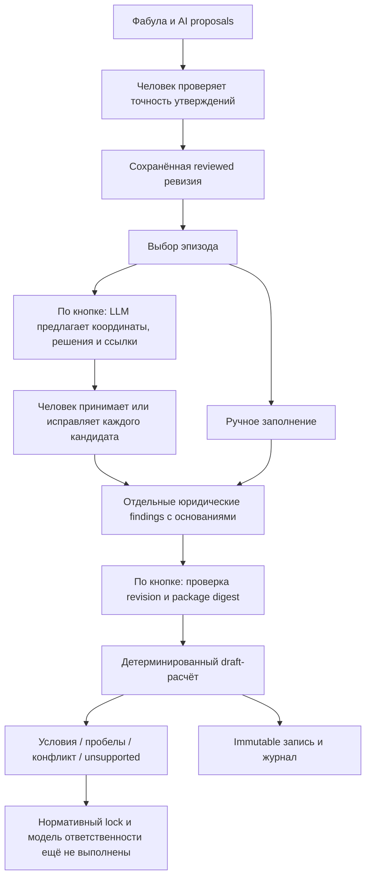

# Юридические обстоятельства и нормативный фрагмент

Дата: 2026-10-22. Задача: [#190](https://github.com/SoundBlaster/NormLab/issues/190).

## Какую норму считаем

Пилот — **часть 2 статьи 8.14 КоАП города Москвы**, Закон Москвы от 21.11.2007
№ 45. Это региональный акт. Федеральный **КоАП РФ** содержит общие положения,
которые нужны для вывода об ответственности; московская статья не становится
статьёй федерального кодекса. План интервью выбрал именно этот фрагмент.

Сейчас реализован **draft-расчёт условий фрагмента**, а не полная квалификация.
Реестр [PARKING_SOURCES.md](PARKING_SOURCES.md) ещё не закрывает нормативный lock.
Проверка текста, человеческое установление обстоятельства, проверка редакции и
доказательство вычисления — четыре разные операции.

Подготовлены [отдельный архив источников](sources/moscow-parking/2026-10-22/README.md)
и [пять планов прохождения](../fixtures/parking-pilot/walkthroughs/README.md).
Архив не изменяет identity исполняемого manifest и не закрывает нормативный lock.

Для PoC подключена [независимая проверка модели в Lean](PARKING_LEAN_POC.md).
Нормативный lock и юридическая экспертиза не блокируют этот демонстрационный
scope: Lean проверяет явно заданные правила упрощённой модели.

## Пакет норм

Исследовательский manifest:
[norms/moscow-parking/manifest.json](../norms/moscow-parking/manifest.json).

| Слой        | Представление                                                                              |
| ----------- | ------------------------------------------------------------------------------------------ |
| Identity    | ID, semantic version, юрисдикция RU-MOW, акт и статья                                      |
| Источники   | Официальные URL, locator, вид evidence и ограничение редакции                              |
| Условия     | Stable condition IDs, вопросы, подсказки, source refs                                      |
| Границы     | Обычная городская парковка, гражданин и личный легковой автомобиль                         |
| Исключения  | Ошибки/исправления/поздняя оплата, льготы, особые тарифы и обстоятельства дают unsupported |
| Последствие | 5 000 ₽ только как санкция-кандидат исследованной редакции                                 |
| Readiness   | research-draft, currentLawVerified=false, liabilityModelComplete=false, proof=none         |
| Зависимости | Применимая редакция, действующие правила оплаты и общая часть КоАП РФ остаются открытыми   |

Существующий `normlab.norm-package/v1` и `legal-ir/v2` обслуживают synthetic
reform-D16 с M/N/E и валютой DEMO. Они не являются универсальным форматом
КоАП и не используются для представления настоящей нормы как synthetic fixture.
У парковочного draft собственный узкий контракт. Для полноценного пакета
сохраняется design [NORM_SOURCE_PROVENANCE.md](NORM_SOURCE_PROVENANCE.md):

```text
NormPackage
  manifest: jurisdiction / identity / version / readiness
  source snapshots: original bytes + extracted text + separate SHA-256
  fragments: article / part / point / exact quote / edition / effective dates
  vocabulary: concepts and links to case ontology
  rules: predicates / exceptions / consequence / formalization rationale
  dependencies: federal general provisions and municipal payment rules
  reviews: source / edition / semantics, with unresolved dependencies
```

Это структура будущего нормативно locked пакета, а не уже реализованный архив
источников. FAQ не заменяет нормативный акт, URL не заменяет snapshot, digest
не доказывает актуальность. S01/S04/S07 связаны с исследовательским реестром;
историческая редакция S04 не объявлена действующей. Сумма не назначается при
unknown/conflict/unsupported и даже при совпадении условий остаётся draft-кандидатом.

## Переход от слов к решениям



Подтверждённое «я заплатил» означает, что человек проверил корректность
разметки слов. Юридическое решение о платеже дополнительно относится к
конкретному ТС, месту и интервалу. Баланс счёта и попытка оплаты не подменяют
успешную своевременную оплату правильных реквизитов за весь интервал.

У finding пять состояний: `unreviewed`, `established`, `refuted`,
`not-established`, `conflict`. Для рассмотренного состояния обязательно
основание. Можно сослаться на подтверждённые утверждения того же эпизода
или записать собственное дополнение. Цитата сохраняет provenance, но не доказывает
истинность. Противоречащие цитаты не разрешаются автоматически: человек
сохраняет конфликт либо объясняет выбор в основании. Это не юридическая экспертиза.

Все новые findings начинаются с `unreviewed`, без переноса model decisions.
При изменении эпизода, участника, ТС, даты или места локальные findings
сбрасываются. Новая текстовая ревизия не наследует решения; старые записи
сохраняются. Вид ТС не выводится из «я припарковался»;
личный легковой автомобиль — отдельный scope gate.

## Подготовленные кандидаты перед Lean

Расширение PoC от 2026-10-24: [задача #207](https://github.com/SoundBlaster/NormLab/issues/207).
После завершения проверки текста можно выбрать эпизод и нажать кнопку подготовки
кандидатов. LLM делает механическую часть: предлагает координаты и сопоставляет
девять условий пакета с уже проверенными утверждениями. Повторного extraction нет.

1. Проверить и принять предложенные координаты: участник, ТС, место, дата, интервал.
   Неизвестное поле остаётся пустым; рядом указан вопрос для уточнения.
2. У каждого условия прочитать предлагаемое состояние, краткое основание и цитаты.
   Принять решение отдельно либо открыть ручной редактор и исправить его.
3. Нажать «Рассчитать и проверить в Lean». Сохранение и расчёт используют только
   текущие решения человека. Неодобренные предложения сами во входы не попадают;
   оставленные `unreviewed` дают неполноту результата.

Одобрение переносит состояние, основание и ссылки вместе. Контролы для ручного
заполнения доступны; без configured gateway или при сбое можно продолжить вручную.
Новый набор кандидатов не заменяет ранее принятые решения. Изменение координат
требует подтверждения сброса введённых findings. Результаты предыдущего расчёта
сохраняются и помечаются как устаревшие при локальных изменениях.

### Вызов и provenance

- `POST /api/parking/legal-proposals`: `draftId`, `expectedRevisionId`,
  `expectedAssessmentId`, `episode`. Ответ — отдельный `SavedLegalProposal`.
- `GET /api/parking/legal-proposals/:draftId`: доступность gateway и до десяти
  последних завершённых предложений текущей ревизии/пакета.
- Сервер строит compact input только из confirmed утверждений выбранного эпизода,
  проверяет цитаты и SHA-256 источника. Клиент не задаёт prompt, model или endpoint.
- Один structured Responses call через существующий classification provider,
  `/v1/legal-proposal` внутреннего gateway, те же quota/auth/egress. Новые ключи,
  провайдеры и сетевые направления не нужны. Обновить нужно приложение **и gateway**.
- Вход ограничен 128000 bytes до inference; provider использует действующий
  timeout и output cap classification. На клиенте 150 секунд. Автоматических
  retries нет; неизвестный исход показывается явно, прежде чем делать новый вызов,
  можно загрузить сохранённый ответ.
- Модель не может присвоить approval или provenance. Ссылки проверяются по ID
  подтверждённых утверждений этого эпизода. Непустые координаты и состояния
  `established`/`refuted`/`conflict` требуют ссылок; все девять условий обязательны.
  Эти проверки не доказывают смысловую корректность или достаточность цитат.
- Receipt: `parking-review/<draftId>/legal-proposal-<UUID>/` содержит `input.json`,
  `proposal.json`, `journal.json`; права файлов 0600. Сохраняются prompt/config/input
  digests, model и известный usage. CAS ревизии и assessment head повторяется после
  запроса; результат при конфликте не доступен для одобрения.
- Одобренный finding содержит optional `proposalId`, координаты — optional
  `coordinateProposalId`. Это «подготовлено на основе кандидата», человек может
  изменить значения. Точное окончательное решение остаётся в assessment; ссылка
  позволяет отдельно открыть исходный кандидат. Сервер проверяет completed receipt,
  его входы и актуальную привязку перед сохранением и после Lean.
- Старые assessments без optional provenance читаются без изменения inputDigest.
  Digest профиля Lean включает исходник контракта, поэтому после обновления
  старые proofs корректно отображаются как проверенные предыдущим профилем.
- Журнал показывает запуск, завершение, конфликт, ошибку или незавершённый запрос.
  Генерация кандидатов не создаёт assessment и не запускает Lean.

### Граница проверки изменения

TypeScript/lint/форматирование и review исходников проверяют интеграцию. Платные
запросы и browser walkthrough в этом проходе не выполняются; улучшение качества
или удобства пока не измерено. Следующий контроль после review/deploy — пройти
один парковочный пример и проверить координаты, каждое основание и фактический
результат Lean. Нормативный пакет и правила evaluator этим изменением не расширяются.

## Несколько уточняющих вопросов

Развитие PoC: [задача #216](https://github.com/SoundBlaster/NormLab/issues/216).
Под результатом расположен список **всех текущих** пробелов и противоречий
выбранного эпизода. Он строится из текущих входов формы, поэтому доступен и до
первого расчёта. Установленные и опровергнутые условия повторно не спрашиваются.

- Для отсутствующих участника, ТС, места, даты и интервала — короткие поля ввода.
  Неизвестное можно оставить пустым. Пустое поле не превращается в отрицание.
- Для `unreviewed`, `not-established` и `conflict` — вопросы с явными вариантами.
  Состояния условия и ответы пользователя сопоставлены в page-local model.
  Например, «Был ли сбой?» → «Нет» устанавливает `noSpecialCircumstances`;
  «Да» опровергает этот scope gate. Это не вывод об ответственности.
- Оплата имеет отдельные варианты: отсутствие оплаты, успешная своевременная
  оплата всего интервала, неоднозначная попытка и неизвестность. Попытка оплаты
  не становится ни успешной оплатой, ни установленной неуплатой.
- «Не знаю» даёт `not-established`, а при исходном `conflict` сохраняет конфликт.
  Для его разрешения утвердительным/отрицательным ответом нужно объяснение.
  Исходные утверждения остаются в разборе; при неизменном scope ссылки сохраняются.

Пользователь может ответить на часть вопросов и нажать **«Проверить подготовленные
изменения»**. Preview показывает старое/новое состояние и подготовленное основание
«Уточнение пользователя…». До подтверждения входы расчёта не меняются.
**«Подтвердить и сохранить ответы»** переносит ответы в форму и вызывает существующий
`POST /api/parking/legal` с action `save`. Это одна immutable assessment-запись,
а не дополнительное хранилище ответов. После подтверждённого сохранения можно
перезагрузить страницу и продолжить с оставшимися вопросами. Неподтверждённый
черновик ответов хранится только в памяти страницы; кнопка отмены возвращает
обычное редактирование.

Если заполняются отсутствующие координаты, preview отдельно предупреждает о
сбросе прежних findings и перечисляет их. Они не переносятся на уточнённую область
автоматически. Ответы, подтверждённые в этом же preview, применяются к новым
координатам без старых ссылок. Остальные условия снова требуют review и появляются
в списке вопросов. Старые сохранённые assessments не меняются.

Пока есть черновик ответов, остальные редакторы и переключение исходной ревизии
заблокированы. Изменение базовых входов инвалидирует preview. Подтверждение
передаёт в save именно подготовленный snapshot, не значения из предыдущего React
render. Сохранены expected revision/head/package, request ID и повтор неизвестного
исхода тем же запросом. При ошибке подтверждённые человеком изменения остаются
в форме; сообщение и retry доступны у блока уточнений. После save предлагается
отдельная кнопка пересчёта Lean.

Вопросы и подготовка изменений не используют LLM и не вызывают сеть. Запрос save
не запускает Lean; расчёт выполняется отдельно. Новых нормативных правил,
изменений manifest, shared contracts и proof profile нет. Текущий implementation
проход проверяется TypeScript/lint/форматированием/build и чтением кода;
новые tests, live provider calls и deployment в него не входят.

## Вычисление

[shared/parking-legal.ts](../shared/parking-legal.ts) содержит чистый evaluator.

| Outcome          | Условие                                                |
| ---------------- | ------------------------------------------------------ |
| conflict         | Есть finding с конфликтом                              |
| unsupported      | Опровергнута граница поддержанного сценария            |
| incomplete       | Не рассмотрено или не установлено обязательное условие |
| fragment-refuted | Все входы рассмотрены; основное условие опровергнуто   |
| fragment-matched | Все включённые условия установлены                     |

Консервативный порядок сохраняет обязательные проверки scope даже при раннем
опровержении. Это не правило российского доказывания. При единственном открытом
условии UI показывает две гипотетические ветви на один шаг. Они не меняют findings
и не перечисляют декартово произведение неизвестных обстоятельств.

Сам outcome не устанавливает `guilty`, полную ответственность, действующую
на дату события санкцию или статус отдельной Lean verification. Всегда сохраняются
`normativeStatus=research-draft`, `liability=not-assessed`, `proof=none`.
Пользователь не может снять нормативный gate подтверждающей галкой.

Упомянутый штраф сравнивается только с доступным draft-кандидатом:
draft-match / draft-difference / not-computable. Это не проверка постановления.

## API, хранение и актуальность

- `GET /api/parking/legal/:draftId` возвращает manifest, его SHA-256 и историю.
- `POST /api/parking/legal` принимает только входы, action save/calculate,
  ожидаемые revisionId / assessmentId / packageDigest и requestId.
- Сервер проверяет current reviewed ревизию, checklist, metadata, эпизод и ссылки.
  Клиент не присылает результат или подменённый пакет.
- Сохранение и расчёт — одна immutable запись в
  `parking-review/<draftId>/legal/<requestId>.json` с mode 0600: actor, время,
  sequence, source digest, точные входы, snapshot manifest и результат.
- Незаполненные дата, интервал, место, участник или ТС сохраняются как пробелы и блокируют совпадение фрагмента. Некорректная непустая дата отклоняется.
- Один requestId с теми же входами возвращает прежнюю запись. Другие входы с тем
  же ID отклоняются. При неизвестном сетевом исходе UI предлагает повтор именно
  этого запроса; автоматического повтора нет.
- Пока есть несохранённые юридические правки, выполняющийся запрос или неизвестный
  исход сохранения, родительский экран блокирует смену черновика/ревизии и правки
  исходной разметки. Сам редактор обстоятельств остаётся доступен для сохранения,
  повтора прежнего запроса либо явной отмены правок с подтверждением. Неизвестный
  запрос нельзя потерять обычным переключением.
- Optimistic assessmentId предотвращает тихое перетирание из другой вкладки.
  Записи дают события в общем журнале. Ошибка не превращается в успех.
- Результат показывается как старый при локальных правках, непроверенном тексте
  или неподтверждённом сохранении. История другой ревизии отдельно обозначена;
  её findings не становятся новыми принятыми входами.

Хранилище — private single-user demo, без подписанной квитанции и отдельной
защиты от изменения файлов администратором. Reader проверяет bindings и пересчёт
для единственной поддержанной версии. Изменение семантики требует новой версии
и reader/replay для исторических пакетов; тихая миграция результатов запрещена.

## Дальнейшая юридическая полнота

Для правового вывода нужно закрыть snapshot/edition lock, проверить федеральные
условия и получить review формализации. После этого можно расширить evaluator,
контракт проверки и подготовить тесты с экспертными expected outcomes.
Настоящий этап соединяет UI и draft-вычисление; исследовательский реестр
не становится готовой действующей моделью права.

Этот gate относится к будущему правовому выводу. Для текущего PoC уже проверены
пять сюжетов и десять результатов в Lean; фактическая проверка хранится отдельно
в `assessment.verification`, а producer сохраняет прежний `result.proof=none`.
Следующий ход PoC — review и обновление демо.
